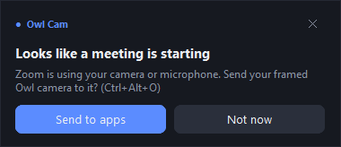
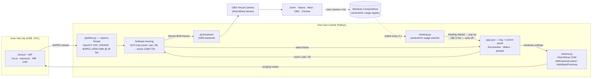

# Owl Cam Control

**A free Windows tray app that unlocks real controls for the Kreo Owl Lite webcam: zoom, framing, focus, exposure, color, presets and meeting automation. Use the camera you already own like a studio camera in Zoom, Teams, Google Meet, OBS or any other app.**

> **The camera:** [Kreo Owl Lite Full HD Webcam, 1080p 30 FPS, Auto-Focus, Dual Digital Mic (Amazon.in)](https://www.amazon.in/dp/B0FLJD9JM3)
>
> It's an affordable 1080p USB webcam with good optics. Windows gives you almost no control over it, though. The built-in Camera app has no zoom, framing or manual focus, and the camera's advertised pan/tilt/zoom doesn't actually move the picture. This app fills that gap.

---

## What you can do with it

| | Feature | What it means for you |
|---|---|---|
| 🎯 | **Zoom 1×–4× and reframe** | Crop in tight on your face or pull back to show the room. Drag the picture to move the frame, scroll to zoom, or use the sliders. |
| 🔍 | **Manual or auto focus** | Lock focus so it stops "hunting" when you move your hands, or leave it on auto. |
| 💡 | **Exposure, brightness, gain, backlight** | Fix a dark room or a bright window behind you without extra lights. |
| 🎨 | **White balance, contrast, saturation, hue, sharpness, gamma** | Get natural skin tones instead of the default blue or yellow cast. |
| 💾 | **Presets** | Save looks such as "Meeting", "Recording" or "Evening", and switch with one click from the panel or the tray. |
| ⭐ | **Default preset** | Pick one preset that is *always* applied: at login, when the camera is replugged, and whenever a meeting starts. |
| 📣 | **Meeting pop-up** | When Zoom, Teams, Meet, etc. starts using your camera or mic, a pop-up asks *"Looks like a meeting is starting"* with a one-click **Send to apps** button. |
| ⌨️ | **Global shortcut `Ctrl+Alt+O`** | Turn the framed camera on or off from anywhere. |
| 🔋 | **Auto-off** | If no meeting is running for 3 minutes, the app releases the camera so it doesn't burn CPU in the background. |
| 🔁 | **Auto-restore** | Settings come back after a reboot or an unplug/replug. Cheap webcams usually forget them. |
| 🖥️ | **Lives in the taskbar tray** | Left-click opens the control panel, right-click opens quick actions. The panel is resizable and works on multi-monitor and high-DPI setups. |

<p align="center"></p>

---

## How it works

### Two kinds of control

The app controls the camera in **two different ways**, because the Owl Lite only honors some of the settings it advertises:

| Control | Where it happens | Why |
|---|---|---|
| Focus, exposure, white balance, brightness, contrast, saturation, hue, sharpness, gamma, gain, backlight | **In the camera hardware**, via DirectShow `IAMCameraControl` / `IAMVideoProcAmp` | The camera honors these, so every app sees them, even ones that open the camera directly. |
| Zoom, pan, tilt | **In software**, in this app's video pipeline | The Owl Lite *reports* hardware zoom 0–10 and pan/tilt ±11 but its firmware ignores them. Frames captured at zoom 0 and zoom 10 are pixel-identical. So the app crops the 1080p stream itself. |

### Media stream architecture



**Frame by frame:**

1. **Capture.** A background thread opens the Owl Lite with OpenCV's DirectShow backend and requests MJPEG at 1920×1080. The format is passed *at open time*. Setting it afterwards renegotiates the stream once per property and takes ~6 s instead of ~1 s.
2. **Framing.** Each frame is cropped to a 16:9 window whose size is `1/zoom` of the frame. Pan/tilt (−100…100 %) slide that window within the room left over, so it never goes past the edge. The crop is resized to 1280×720. This math lives in `crop_rect()` and is unit-tested.
3. **Publish.** When **Send to apps** is on, the frame goes to `pyvirtualcam`, which writes into the **OBS Virtual Camera** device. Meeting apps select that device like any webcam.
4. **Preview.** The UI thread shows the newest framed frame (~25 fps), so what you see in the panel is exactly what the meeting sees.
5. **Hardware controls** don't touch the stream. They are COM property writes straight to the camera, done on the UI thread (COM single-threaded apartment).

**Threads.** Tk UI and all COM calls run on the main thread. Capture/publish runs on its own thread. The tray icon (pystray) and the global hotkey (`RegisterHotKey` message loop) each have their own thread and hand work to the UI thread through a queue, so Tk is only touched from one thread.

**Pipeline lifecycle.** The camera is opened only when something needs it: Send to apps is on, *or* the panel is open. Hide or minimize the panel with sending off, and the camera is released (LED off, ~0 % CPU).

### Meeting detection

Windows records every app's camera and microphone use under
`HKCU\Software\Microsoft\Windows\CurrentVersion\CapabilityAccessManager\ConsentStore\{webcam,microphone}`.
An entry with `LastUsedTimeStop = 0` means *in use right now*. It's the same signal that lights the mic icon in the taskbar. Every 2 s the app reads it and does the following:

- **Ignores its own Python process** (it's using the camera for the preview) and dictation tools such as Wispr Flow (`meeting_ignore_apps`).
- **Announces a meeting** only after **8 s** of continuous use, so a quick voice note doesn't trigger a pop-up.
- **Switches sending off** after **3 minutes** with no meeting (`auto_off_minutes`). The clock restarts whenever you turn sending on or a meeting ends.

The pop-up is a non-activating tool window (`WS_EX_NOACTIVATE`), so it never steals keyboard focus from your meeting app.

---

## Requirements

- Windows 10 or 11
- Python 3.12+ on PATH
- [OBS Studio](https://obsproject.com/) installed. It provides the "OBS Virtual Camera" device; OBS itself does **not** need to be running.
- A Kreo Owl Lite, or most other USB (UVC) webcams. Hardware controls adapt to whatever the camera reports.

## Install

```
git clone https://github.com/Naveen-S6/owl-cam-control.git
cd owl-cam-control
setup.cmd
```

`setup.cmd` creates a virtual environment, installs pinned dependencies and starts the app. On first run it registers itself to start with Windows; you can turn that off from the tray menu.

## Daily use

1. **Left-click** the blue camera icon in the tray to open the panel. Frame yourself and tune the picture.
2. Save it as a preset (e.g. **Meeting**) and switch on **Always use this preset**.
3. In Zoom / Teams / Meet, pick **"OBS Virtual Camera"** as your camera. You only do this once per app.
4. From then on, when a meeting starts, click **Send to apps** on the pop-up (or press **`Ctrl+Alt+O`**). After the meeting, it switches off by itself.

**Tray menu (right-click):** Open controls · Send to apps (`Ctrl+Alt+O`) · Presets (★ marks the default) · Reset all · Meeting pop-ups · Start with Windows · Quit.

> If a meeting app opens the **Owl Lite directly** instead of the virtual camera, Windows gives it exclusive access, and the panel will tell you to switch that app to "OBS Virtual Camera". Hardware settings (focus, exposure, color) still apply in that case. Only software framing needs the virtual camera.

## Settings

Stored in `%APPDATA%\OwlCamControl\settings.json`. Nothing leaves your PC.

| Key | Default | Meaning |
|---|---|---|
| `camera_name` | `"Owl"` | Part of the camera's name (run `python camera.py` to list cameras) |
| `default_preset` | `null` | Preset applied at startup, on reconnect and when sending starts |
| `auto_off_minutes` | `3` | Minutes without a meeting before sending switches off |
| `meeting_popups` | `true` | Show the "meeting is starting" pop-up |
| `meeting_ignore_apps` | `["Wispr Flow"]` | Apps that use the mic but aren't meetings |

Errors are logged to `%APPDATA%\OwlCamControl\app.log` (rotated, 1 MB).

## Performance

While sending, the app decodes 1080p MJPEG and feeds the virtual camera at 30 fps. That's about **1–1.5 CPU cores**, ~6 % of a 20-thread laptop CPU. With sending off and the panel closed it uses no camera and next to no CPU. That's why auto-off exists.

## Project layout

| File | Responsibility |
|---|---|
| `app.pyw` | Tray icon, control panel (CustomTkinter), global hotkey, presets, camera reconnects |
| `pipeline.py` | Capture thread, software framing (`crop_rect`), OBS Virtual Camera output |
| `camera.py` | DirectShow COM access to hardware controls (`python camera.py` prints what your camera supports) |
| `meeting.py` | Camera/mic usage reader and the meeting / auto-off state machine |
| `ui.py` | Shared palette, monitor helper, pop-up notification |
| `store.py` | Settings JSON (atomic writes, corrupt-file recovery) and the start-with-Windows entry |
| `test_*.py` | Unit tests for framing math, meeting logic and settings |

## Development

```
.venv\Scripts\python.exe -m unittest      # run tests
.venv\Scripts\python.exe camera.py        # list cameras and their hardware control ranges
.venv\Scripts\python.exe meeting.py       # show which apps are using camera/mic right now
.venv\Scripts\pythonw.exe app.pyw         # run the app
```

Built with [comtypes](https://github.com/enthought/comtypes), [OpenCV](https://opencv.org/), [pyvirtualcam](https://github.com/letmaik/pyvirtualcam), [CustomTkinter](https://github.com/TomSchimansky/CustomTkinter), [pystray](https://github.com/moses-palmer/pystray) and [Pillow](https://python-pillow.org/).

*Not affiliated with Kreo. "Owl Lite" is used only to identify the camera this was built and tested with.*
